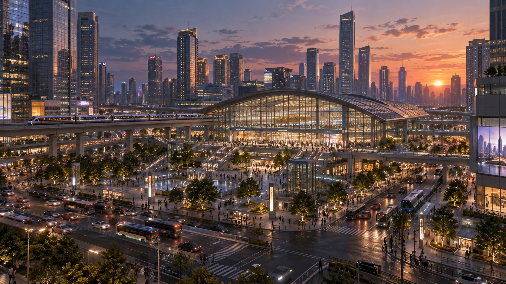
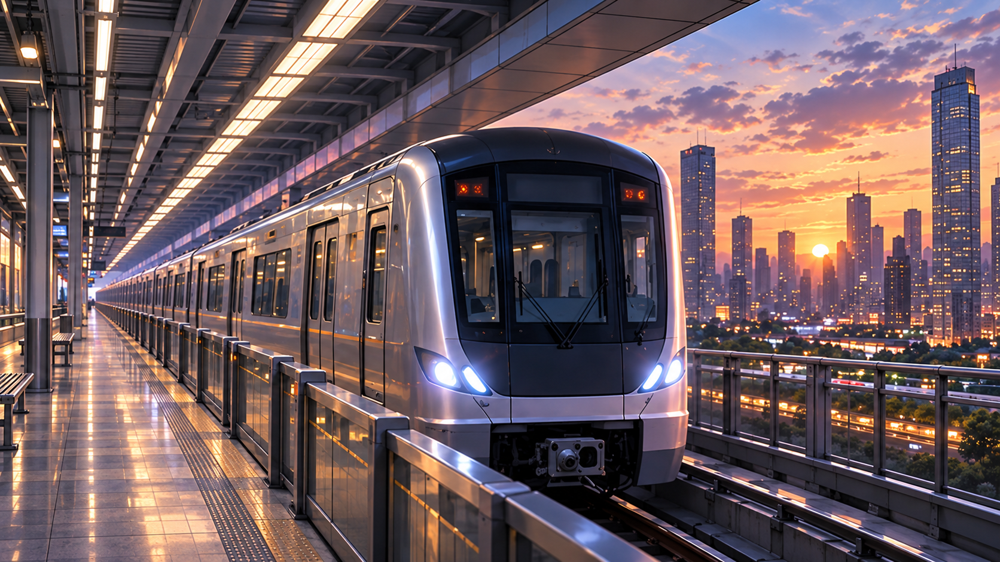

# 地铁的另一座城市｜先导宣传概念片

本仓库供 Grok Build 或其他制作工具读取图片与制作说明。**当前交付为静态素材与制作交接，不是已完成的视频或正式剧集定稿。**

## 从这里开始

1. 阅读 [给 Grok Build 的制作说明](production/给Grok_Build的制作说明.md)。
2. 查看 [建议分镜](production/建议分镜.md) 与 [素材使用矩阵](production/素材使用矩阵.md)。
3. 优先读取 [8 张主选关键帧](production/01_主选关键帧/)。
4. 按需读取 [5 张辅助参考](production/02_辅助参考_按限制使用/)，包含三视图、表情、服装道具、车厢与原始分镜。

本片人物以主选03/04/07为准：浅色外套、灰色帽衫、黑色背包。旧三视图的职场装、低盘发和单肩包不是本片换装要求。车型以02/05为准，不混入古典圆头机车。08为镜像世界日常街道，不是现实世界。

## 素材目录

|目录|用途|
|---|---|
|production/01_主选关键帧|8张概念片主图：双城、列车、通勤、发现异常、抵达、镜像日常|
|production/02_辅助参考_按限制使用|5张辅助图，逐项用途见素材使用矩阵|
|production/03_来源与记录|上一轮来源、提示词、实际尺寸与限制|
|archive/original-handoff|完整原始交接资料，23张PNG与历史设定、预检、来源清单|

历史资料有意保留，部分图片与制作目录重复，以维持原交接包完整性。不要把历史候选全部喂入同一次生成。旧文档中的任务命令和未定设定只作为历史材料，当前制作说明优先。

## 给接手工具的入口

请先读取本README、production/给Grok_Build的制作说明.md、production/建议分镜.md、production/素材使用矩阵.md，再查看production/01_主选关键帧中的8张PNG。先确认实际能访问哪些图片，不要仅根据文件名假装已看图。按可用能力完成先导概念片；能力不足时报告具体限制并交付可执行分镜/提示词。不要自动发布。

暂以16:9、45—60秒作为试剪选项，尚未锁定正式规格。主选图片7张为1672×941、1张为1659×948；没有伪称4K。未做图生视频或动态连续性验证，也未验证Grok Build是否能直接读取私有仓库内的图像。

## 主选预览

### 01_现实城市_原图

### 02_现实列车_整理版

### 03_周遥通勤_整理版

### 04_发现另一座城市_整理版

### 05_魔法列车_整理版

### 06_镜像城市_原图

### 07_抵达镜像站厅_整理版

### 08_镜像城市日常街道_新增

